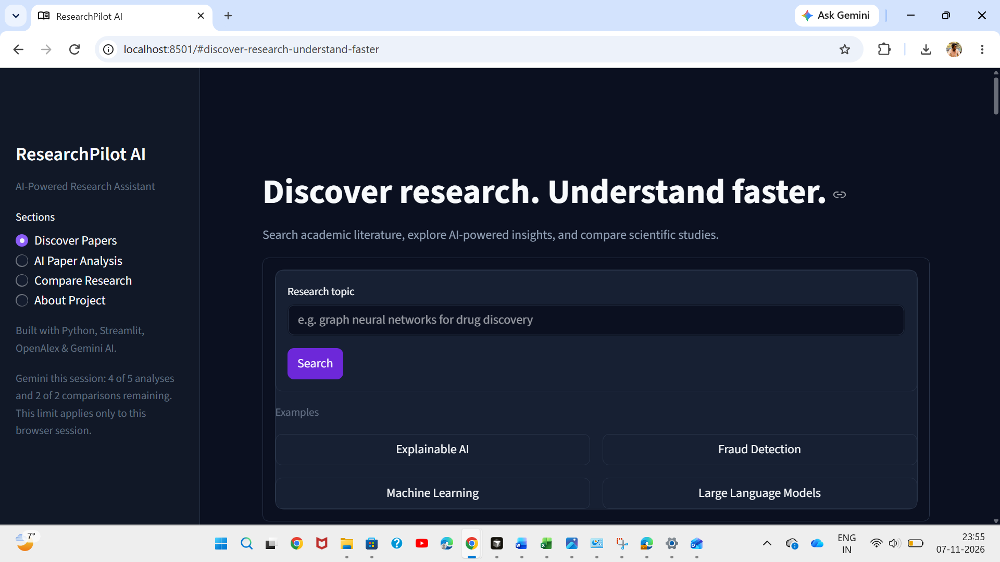
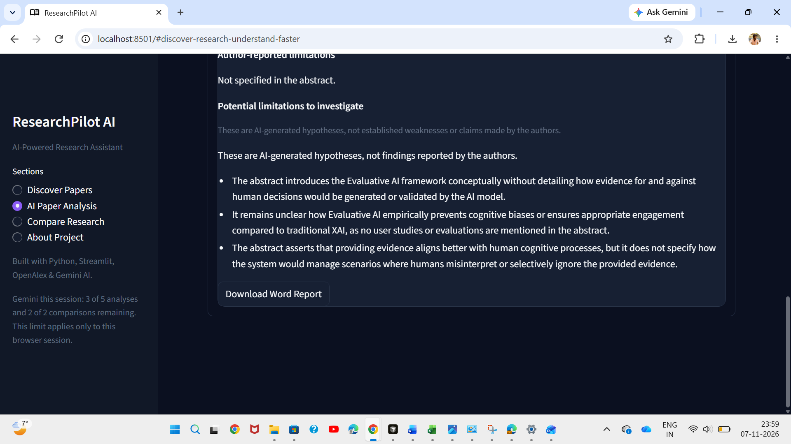
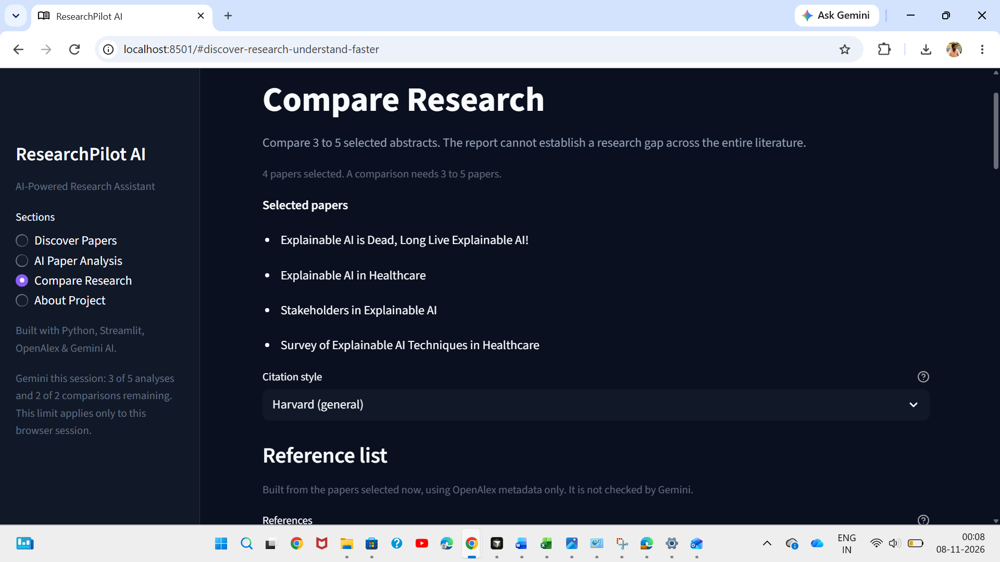
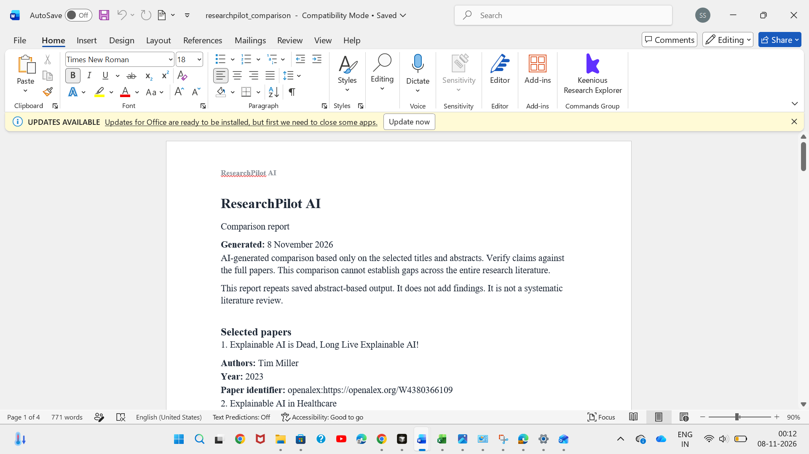

# ResearchPilot AI

ResearchPilot AI is a portfolio project for discovering academic papers and reading their abstracts with more structure. It searches the public OpenAlex catalog, analyses one abstract with Google Gemini, compares three to five selected abstracts, builds APA 7 and general Harvard citations from the metadata, and downloads those saved results as an editable Word report.

It is a study tool for a final-year Data Science and AI project. It does not read full papers, and it does not replace a literature review.

## Features

- **OpenAlex paper discovery.** A topic search returns up to 10 works from `https://api.openalex.org/works`. OpenAlex does not require an API key. Each card shows the title, authors, year, DOI, source link, and abstract when OpenAlex provides them. Abstracts are rebuilt from OpenAlex's inverted index.
- **Single-paper abstract analysis.** **Analyse with AI** sends one title and abstract to Gemini (`gemini-3.5-flash-lite`). The result has Research Objective, Methodology, Key Findings, and Limitations. Limitations separate author-reported limits from AI hypotheses.
- **Comparison of 3–5 papers.** **Compare Selected Papers** sends one Gemini request for the selected abstracts. The report has six sections: Research Objectives, Methodologies, Key Findings, Author-Reported Limitations, Author-Reported Research Gaps, and AI-Inferred Potential Research Gaps. Papers without an abstract cannot be selected.
- **APA 7 and general Harvard citations.** Each result has a reference and an in-text citation. Compare Research also builds a reference list for the current selection. Formatting uses OpenAlex metadata only. Missing authors, year, venue, or DOI are flagged and left blank.
- **Editable Word report export.** A saved analysis or a saved comparison can be downloaded as a `.docx` file. The file is built in memory. The download does not call Gemini, and the document can be edited in Word.
- **Dark Streamlit dashboard.** The sidebar has four sections: Discover Papers, AI Paper Analysis, Compare Research, and About Project. The dark theme is set in `.streamlit/config.toml` and `researchpilot/theme.py`.
- **Session-based Gemini limits.** One browser session allows 5 analyses and 2 comparisons. The sidebar shows how many remain. A successful cached result does not use another request. A failed request that was actually sent does. A missing key, a paper with no abstract, and an invalid selection do not.
- **Caching and stale-result protection.** A saved analysis stays with that paper's OpenAlex id, DOI, or title and year, so it does not move to another card. A comparison is reused only for the same papers and the same abstract text, in any order. A new search clears the selection and drops results that no longer match the current papers.

## How It Works

Search → Select → Analyse → Compare → Cite → Export

1. **Search** on Discover Papers. OpenAlex search works without a Gemini key.
2. **Select** 3 to 5 papers that have abstracts.
3. **Analyse** one paper. This calls Gemini and needs `GEMINI_API_KEY`.
4. **Compare** the current selection. This is a separate Gemini call and needs the same key.
5. **Cite** from the paper card or the Compare Research reference list. Citations do not call Gemini.
6. **Export** a Word report from a saved analysis or a saved comparison. Export uses the result already stored in the session.

AI analysis and comparison require a configured Gemini API key. Search, citations, and downloads of results that are already saved do not.

## Technology Stack

- Python 3.10 or newer (Python 3.12 for Streamlit Community Cloud)
- Streamlit
- OpenAlex API
- Google Gemini API, through `google-genai`
- `python-docx` for Word reports
- `requests` for the OpenAlex client
- `python-dotenv` for a local `.env` file
- `pytest` for the test suite

## Project Architecture

```text
app.py                          Streamlit dashboard
researchpilot/
  models.py                     Paper record and stable analysis key
  abstracts.py                  Rebuilds an abstract from an inverted index
  openalex.py                   Search, parsing, and duplicate handling
  analyzer.py                   Single-paper Gemini analysis
  comparison.py                 Selection rules, comparison, and cache identity
  citations.py                  APA 7 and general Harvard formatting
  export.py                     In-memory Word reports
  usage.py                      Per-session Gemini request limits
  theme.py                      Dashboard CSS
.streamlit/config.toml          Dark Streamlit theme
tests/                          Unit and Streamlit tests, with mocked APIs
requirements.txt
pytest.ini
```

A paper is identified by its OpenAlex id, then its DOI, then its title and year. Duplicate records that share an OpenAlex id or a DOI are collapsed. Papers that share a title but have different identifiers stay separate.

## Installation

These steps use Windows PowerShell. Clone the repository, then install the dependencies into a virtual environment.

```powershell
git clone https://github.com/ShivaGoudBongu/ResearchPilot-AI.git
Set-Location ResearchPilot-AI
python -m venv .venv
.\.venv\Scripts\Activate.ps1
python -m pip install --upgrade pip
pip install -r requirements.txt
```

If activation is blocked, allow scripts for the current window and activate again:

```powershell
Set-ExecutionPolicy -Scope Process -ExecutionPolicy Bypass
.\.venv\Scripts\Activate.ps1
```

Create a file named `.env` in the project folder. Do not commit it. Replace the placeholder with your own key.

```text
GEMINI_API_KEY=your-key-here
```

`OPENALEX_MAILTO` is optional. An email address puts OpenAlex requests in the polite pool. It is not an API key.

```text
OPENALEX_MAILTO=you@university.edu
```

Start the app:

```powershell
streamlit run app.py
```

Streamlit opens a local page, usually `http://localhost:8501`. Restart the app after you change `.env`.

## Testing

From the activated virtual environment:

```powershell
python -m pytest
```

The same suite can be run without activation:

```powershell
.\.venv\Scripts\python.exe -m pytest
```

At commit `3f062d9`, this suite passed 88 tests. That number describes that checkpoint. It will change if tests are added or removed.

The tests mock OpenAlex and Gemini. They do not need a live network connection or a Gemini API key.

## Public demo mode

Set this for a public Streamlit deployment. Either source is enough, and a `false` value from the other source does not turn the demo off.

```text
RESEARCHPILOT_PUBLIC_DEMO=true
```

```toml
RESEARCHPILOT_PUBLIC_DEMO = true
```

The environment variable is the string `true`. In Streamlit secrets, unquoted `true` is a boolean. Streamlit copies string secrets into environment variables and leaves booleans in `st.secrets`. The app checks both.

Gemini analysis and comparison are unavailable in that mode. The app does not send Gemini requests, and visitors cannot turn Gemini back on. OpenAlex search, paper browsing, citations, reference lists, and navigation keep working. A public demo does not need a Gemini API key.

Leave the variable unset, or set it to `false`, on your own machine, and do not set the secret to true. Local Gemini then works with your own `GEMINI_API_KEY`, including the session limits of 5 analyses and 2 comparisons.

A Word download appears only for an analysis or comparison already saved in the current browser session. A fresh public session has no saved AI result, so it does not offer a download.

## Deployment

Streamlit Community Cloud can run this repository when you are ready to deploy it. A public deployment has not been created yet, so there is no live demo URL.

When you deploy, use these settings:

- Repository: `ShivaGoudBongu/ResearchPilot-AI`
- Branch: `main`
- Main file: `app.py`
- Python version: 3.12

For a public demo, set `RESEARCHPILOT_PUBLIC_DEMO = true` in the Cloud secrets editor and do not add a Gemini key. For a private deployment that uses Gemini, add the key as a top-level string secret. Use your own key. Do not commit it.

```toml
GEMINI_API_KEY = "your-key-here"
OPENALEX_MAILTO = "you@university.edu"
```

`OPENALEX_MAILTO` is optional. Search still works if `GEMINI_API_KEY` is absent. Analysis and comparison show an error until the key is set.

The session limits in the app apply to one browser session. They reset when that session starts again. On a public app they do not cap the shared Gemini account.

## Limitations

- Gemini analysis and comparison use the title and the available abstract. They do not read the full paper.
- AI-generated findings need to be checked against the full paper.
- AI-inferred research gaps are hypotheses from the selected abstracts. They are not verified gaps in the literature.
- OpenAlex metadata can be incomplete. Missing authors, year, DOI, venue, abstract, or source are shown as unavailable.
- Citations are generated from that metadata and may need manual verification before use in academic work.
- Harvard output follows a general variant, not one university's house style.
- Volume, issue, and page numbers are not requested from OpenAlex, so citations do not include them.
- A Word report repeats a saved analysis or comparison. It is not a systematic literature review.
- The 5-analysis and 2-comparison limits belong to one Streamlit session. They are not a global quota and they are not billing protection. A new session starts the count again.

## Security

`GEMINI_API_KEY` and the optional `OPENALEX_MAILTO` value come from environment variables. Locally, `python-dotenv` loads them from `.env`. On Streamlit Community Cloud, the same names can be set as top-level secrets.

`.env` and `.streamlit/secrets.toml` are listed in `.gitignore`. The API key is not written into the source code, error messages, or logs. This is appropriate for a student project. It is not a claim of production-grade security.

## Screenshots

### Discover Papers

The search page, with a topic field, example searches, and the session limit in the sidebar.



### AI Paper Analysis

A saved abstract analysis, separating author-reported limitations from AI hypotheses, with a Word report download.



### Compare Research

Four selected papers, a Harvard (general) reference list built from OpenAlex metadata, and the note that Gemini does not check the citations.



### Word report

A downloaded comparison report opened in Microsoft Word, including the disclaimer and the selected papers.


